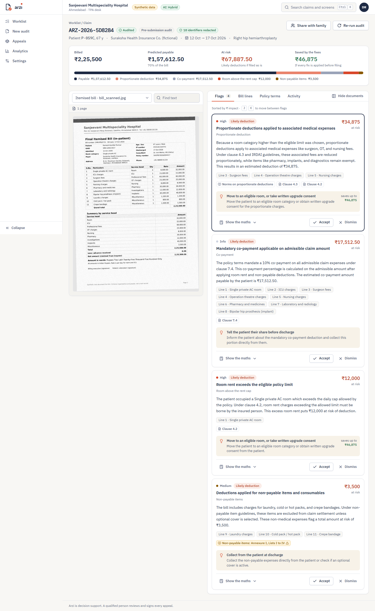

# Arzi

[](https://opensource.org/licenses/Apache-2.0)
[](https://www.python.org/)
[](https://www.typescriptlang.org/)
[](https://cloud.google.com/)
[](https://cloud.google.com/vertex-ai)

**Your claim, defended before and after the insurer says no.** Arzi audits Indian hospital
health-insurance claims before filing, shows every likely deduction with the ₹ at risk and the
exact policy clause or IRDAI rule, and drafts clause-cited appeals that a qualified person
reviews and signs. The patient's family gets the same decision explained in Gujarati, Hindi or
English, with narrated audio, on a private link; anyone can run a free check of a rejection
letter at `/check`.

> Arzi is decision support. A qualified person reviews and signs every appeal.
> All data in this repository is synthetic; hospitals and insurers named in demos are fictional.



**Every screen of the deployed app, with captions:** [`docs/screens/live/`](docs/screens/live/README.md).

**Try it:** run `make dev`, open http://localhost:5173, choose *Continue to the demo workspace*, then *Load demo cases* — three synthetic claims are audited in seconds.

**Event deployment:** ran on Cloud Run (Mumbai) for Startup Buildathon India 2026 and has since been retired; [every screen](docs/screens/live/README.md) was captured from it first. Run it yourself with `make dev`.

**Measured (replay eval, `make eval`):** 11/11 deductions caught, 11/11 exact rupee amounts,
totals exact on all three demo cases. See [`evals/report.md`](evals/report.md). Desk analytics are at `/analytics`.

## Quick start

Prerequisites: [uv](https://docs.astral.sh/uv/), Node.js ≥ 22, GNU Make and bash (Git Bash on
Windows). The Google Cloud SDK is needed only for cloud targets.

```bash
make setup   # Python + Node dependencies, enables the commit-msg hook
make dev     # API on :8000 and web on :5173, LLM calls served from recordings (replay mode)
make check   # lint, types, tests and coverage gates — the same checks CI runs
```

Run `make help` for every target.

## Architecture

FastAPI (Python 3.12) and a React + TypeScript single-page app, shipped as one container on
Cloud Run in `asia-south1` (Mumbai), with Firestore and Cloud Storage in the same region and
Gemini on Vertex AI. Rupee amounts come only from a deterministic rules engine; the model
extracts, explains, cites and drafts. The audit is a Google ADK workflow (extract → redact →
reconcile → policy interpreter → rules engine → flag explainer); every model-written sentence
passes an amount guard and a citation whitelist, and appeals are exported only after a named
reviewer signs them.

- Architecture and the **Built vs roadmap** table: [`docs/architecture.md`](docs/architecture.md) 
- Build plan and status: [`docs/BUILD_PLAN.md`](docs/BUILD_PLAN.md), [`docs/PROGRESS.md`](docs/PROGRESS.md)
- Decisions: [`docs/adr/`](docs/adr/)
- Privacy, DPDP rights and retention: [`docs/privacy.md`](docs/privacy.md)
- Operations, kill switches and billing: [`docs/runbook.md`](docs/runbook.md)

## Configuration

All settings are environment variables declared in
[`api/src/arzi/config.py`](api/src/arzi/config.py) (prefix `ARZI_`, plus `GOOGLE_CLOUD_PROJECT`).
Model IDs are configuration and are never hard-coded; `make models` lists what the project can use.


## Licence

Licensed under the [Apache License, Version 2.0](LICENSE).
Copyright 2026 Darshan Bhavsar.
